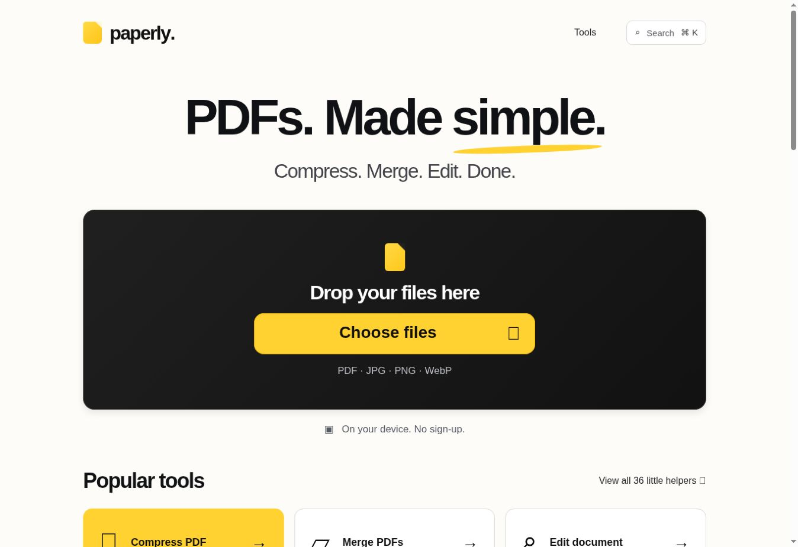
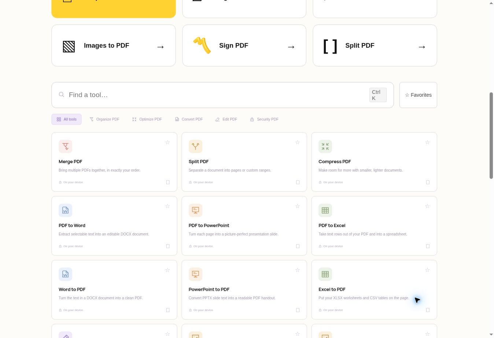
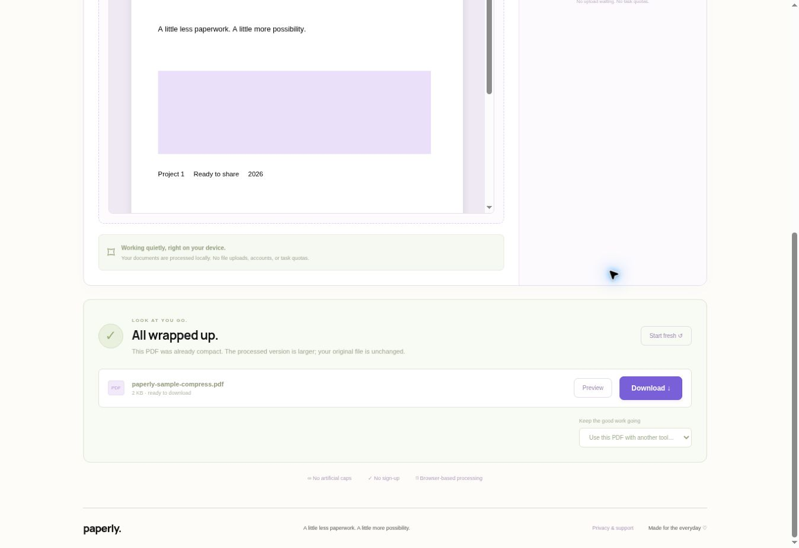
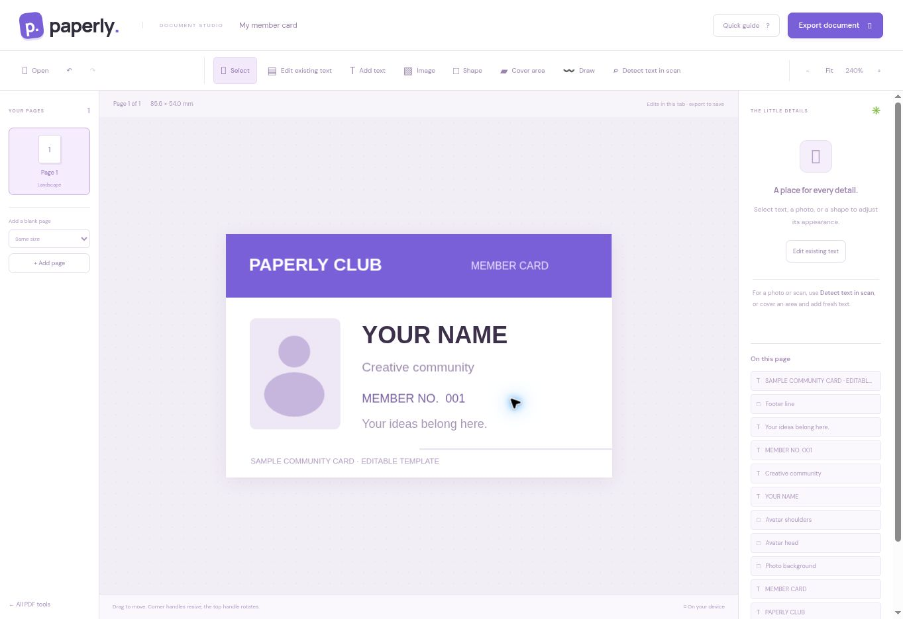

<div align="center">

# 📄 Paperly

### PDFs. Made simple.

**Compress. Merge. Edit. Done.**

A clean, easy-to-use PDF toolkit for converting, organizing, compressing, and editing documents right in your browser.

[](https://paperly-converter-rest.vercel.app/)
[](https://vercel.com/)
[](https://github.com/pranavpk-05/zzz)

**[Try Paperly](https://paperly-converter-rest.vercel.app/) · [View Source](https://github.com/pranavpk-05/zzz)**

</div>

---

## ✨ Overview

**Paperly** puts everyday PDF tasks in one simple workspace. Upload or drag in your documents, choose what you need to do, and download the result — without creating an account.

The interface is designed to make document work approachable, with organized tools, a search feature, and a dedicated document editor.

## 🖼️ Preview

### 🏠 Homepage

A minimal homepage with an easy drag-and-drop upload area and quick access to popular tools.



### 🧰 PDF Tools

Browse or search through tools for organizing, converting, editing, and securing PDFs.



### 🗜️ PDF Compression

A guided PDF compression workflow with a results screen and downloadable output.



### ✏️ Document Editor

Edit document content through a visual interface and export the finished document.



## 🚀 Features

- **PDF organization:** Merge and split PDF files.
- **PDF compression:** Reduce PDF size with a guided workflow.
- **Format conversion:** Access PDF-to-Word, PDF-to-PowerPoint, PDF-to-Excel, and corresponding conversion tools, plus image-to-PDF options.
- **Document editing:** Work inside a visual document editor and export your edits.
- **PDF signing:** Add a visual signature to a PDF (not a certificate-verified digital signature).
- **Quick tool discovery:** Search tools and browse by category.
- **Drag and drop:** Add files directly to the workspace.
- **Browser-based workflows:** The live application states that documents are processed locally on your device.
- **No sign-up or advertised daily quotas:** Use the hosted workspace without registering.

> Some tools, conversions, and editing operations may have format or browser limitations. Check the live app for supported workflows.

## 💻 Live Demo

**Website:** [https://paperly-converter-rest.vercel.app/](https://paperly-converter-rest.vercel.app/)

You can try the app directly from your browser — no local installation needed.

## 📖 How to Use

1. Open the **[Paperly website](https://paperly-converter-rest.vercel.app/)**.
2. Select a tool or search for the operation you need.
3. Choose your file(s) or drag and drop them into the workspace.
4. Adjust the available settings, if needed.
5. Run the operation and download the result.

## 🔐 Privacy

Paperly advertises **on-device, browser-based document processing**, meaning its supported document workflows are designed to run locally rather than requiring files to be uploaded for processing. It also advertises no sign-up requirement, no added watermarks, and no artificial task quotas.

For confidential documents, review the current application's privacy information and your organization's document-handling policies before use.

## 📁 Screenshot Folder Structure

For the screenshots above to appear on GitHub, keep the following files in the repository:

```text
zzz/
├── README.md
└── docs/
    └── screenshots/
        ├── 01-homepage.jpg
        ├── 02-tools.jpg
        ├── 03-compress-pdf.jpg
        └── 04-document-editor.jpg
```

## 🧑‍💻 Local Development

This README focuses on the deployed application's documented behavior. Local setup instructions and the technology stack should be added after confirming the repository's actual configuration and scripts.

## 🤝 Contributing

Contributions and suggestions are welcome. Fork the repository, create a branch for your changes, test them, and submit a pull request. You can also open an issue to report problems or suggest improvements (if issues are enabled).

## 👤 Maintainer

Built by **[@pranavpk-05](https://github.com/pranavpk-05)**.

---

<div align="center">

**Paperly — A little less paperwork. A little more possibility.**

[🌐 Open Paperly](https://paperly-converter-rest.vercel.app/)

</div>
